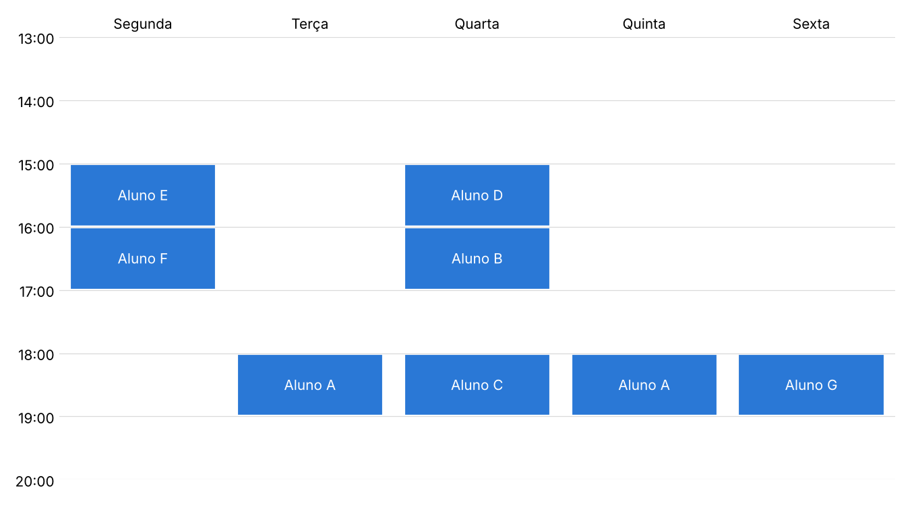
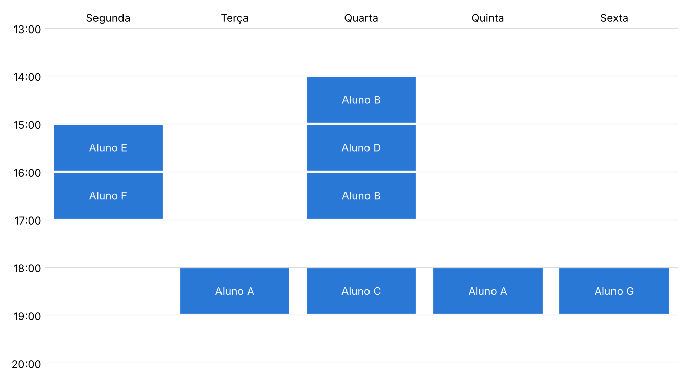

# Otimização do horário de explicações

Modelo de **programação linear inteira** para marcar as aulas semanais de explicações de uma explicadora, tendo em conta a disponibilidade dela, a de cada aluno e os horários que já estão combinados.

O problema nasceu de uma situação real: encaixar vários alunos numa semana em que a explicadora e os alunos têm aulas, treinos e outros compromissos. Os dados deste repositório são **inventados**, só servem para demonstrar o modelo.



## O problema

- Cada aluno precisa de um certo número de aulas por semana (1 ou 2).
- Cada aula dura 1 hora e só pode acontecer quando a explicadora **e** o aluno estão livres.
- Duas aulas não se sobrepõem, mas alunos diferentes podem ter aulas no mesmo dia.
- Cada aluno tem **1 hora por dia**. Em casos excecionais (por exemplo, semana de testes) aceita-se uma segunda aula no mesmo dia, mas a explicadora prefere repartir as aulas por dias diferentes.
- Depois das 19h os alunos já estão cansados, por isso as aulas devem acabar até essa hora sempre que possível.
- Já existem horários combinados com alguns alunos, e convém alterá-los o menos possível.

## O modelo

**Conjuntos.** Alunos $A$, dias $D$ (segunda a sexta) e instantes de início $T$ numa grelha de 30 minutos. Só se criam variáveis para os $(a, d, t)$ em que a aula cabe na disponibilidade da explicadora e na do aluno.

**Variáveis de decisão**

- $x_{a,d,t} \in \{0,1\}$: 1 se o aluno $a$ tem aula no dia $d$ a começar à hora $t$.
- $f_a \in \mathbb{Z}_{\ge 0}$: aulas do aluno $a$ que ficam por marcar.
- $h_{a,d} \in \mathbb{Z}_{\ge 0}$: aulas do aluno $a$ no dia $d$ acima de uma.

**Restrições**

1. Todas as aulas são marcadas, ou ficam em falta: $\sum_{d,t} x_{a,d,t} + f_a = n_a$ para cada aluno $a$.
2. 1 hora por dia para cada aluno: $\sum_{t} x_{a,d,t} \le 1 + h_{a,d}$.
3. Sem sobreposições: para cada dia $d$ e cada instante $m$, $\sum_{a}\sum_{t:\, m-60 < t \le m} x_{a,d,t} \le 1$.

**Função objetivo**

$$\min \; P_f \sum_a f_a \;+\; P_h \sum_{a,d} h_{a,d} \;+\; P_t \sum_{a,d,t} \tau_t \, x_{a,d,t} \;+\; P_c \sum_{(a,d,t) \notin C_a} x_{a,d,t}$$

onde $C_a$ são os horários já combinados com o aluno $a$ (a última parcela só conta para alunos que têm combinado) e $\tau_t$ é o número de meias horas de uma aula que começa em $t$ e acaba depois das 19h (0 se acabar até às 19h). Usei $P_f = 100$, $P_h = 30$, $P_t = 5$ e $P_c = 3$: deixar uma aula por marcar é muito pior do que dar duas aulas ao mesmo aluno no mesmo dia, e isso é pior do que marcar uma aula tarde ou mudar um horário combinado.

A regra de 1 hora por dia é uma **preferência** (restrição suave). Se fosse rígida, uma semana de testes em que um aluno só pudesse num dia ficaria sem solução.

## Resultados com os dados de exemplo

São 7 alunos e 8 aulas por semana.

| Cenário | Aulas marcadas | Dias com 2 aulas do mesmo aluno | Aulas fora do combinado |
|---|---|---|---|
| Base | 8 de 8 | 0 | 0 |
| Semana de testes: o Aluno B passa a 2 aulas | 9 de 9 | 0 | 1 |
| O Aluno B tem 2 aulas, mas só está livre à quarta | 9 de 9 | 1 | 1 |
| Chega um aluno novo (Aluno H) | 9 de 9 | 0 | 0 |

No caso base, o modelo respeita todos os horários combinados e acaba todas as aulas até às 19h. Na semana de testes, o Aluno B ganha uma segunda aula num dia diferente, que é a opção preferida. Se ele só puder à quarta, o modelo aceita as duas aulas nesse dia, que é o caso excecional previsto, e separa-as para não colidirem com os outros alunos.



Com poucos alunos o problema é pequeno e uma pessoa resolvia-o à mão. O interesse do modelo está em reagir às mudanças (um aluno novo, uma semana de testes, um horário que deixa de servir) sem ter de refazer o horário todo, e em dizer **o que tem de ceder** quando há conflito.

## Como correr

```bash
pip install -r requirements.txt
python horario.py                                   # usa dados_exemplo.json
python horario.py dados_exemplo.json --figura figuras/horario.png
python analise.py                                   # tabela de cenários e figuras
```

Para usar dados próprios, copia `dados_exemplo.json` e altera as disponibilidades, o número de aulas por semana e os horários combinados de cada aluno. O solver é o SCIP, através do OR-Tools.

## Limitações e possíveis extensões

- As aulas têm todas a mesma duração (1 hora). Numa semana de testes podia haver aulas de 90 minutos.
- Não se modelam tempos de deslocação, porque as aulas são em casa da explicadora.
- Os pesos da função objetivo foram escolhidos por julgamento. Seria interessante estudar a sensibilidade da solução a eles.
- O modelo olha para uma semana de cada vez. Podia estender-se a várias semanas.

## Autora

Inês Ferreira
